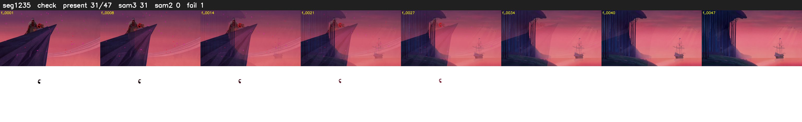

# Segment 1235 (transition)

Film frames 101205-101251 (47 frames, 70:21.1-70:23.1).

**Status: check**

| | |
|---|---|
| Frames with her hair | 31 / 47 |
| Mask source | SAM3 31, SAM2 fallback 0 |
| Frames still failing QC | 1 [15] |
| Film indices with no picture (held) | 0 |
| Time | 72 s |

Top: source with the final mask outlined in red. Bottom: white-fill output.

## Issues

- tinted scene: median hair purity 0.00 < 0.5, purity/missed QC off
- fallback 15-15: no seed prompts (cleaned seed too small (0 px): hair lost)
- other characters' hair erased on 6 frames
