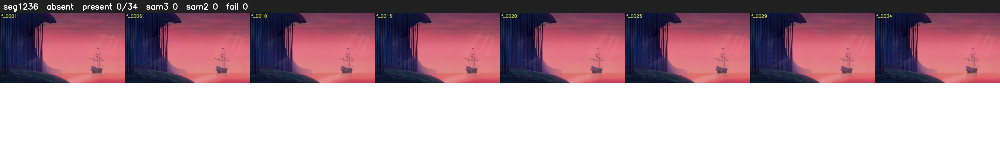

# Segment 1236 (shot)

Film frames 101252-101285 (34 frames, 70:23.1-70:24.5).

**Status: absent**

| | |
|---|---|
| Frames with her hair | 0 / 34 |
| Mask source | SAM3 0, SAM2 fallback 0 |
| Frames still failing QC | 0 [] |
| Film indices with no picture (held) | 0 |
| Time | 9 s |

Top: source with the final mask outlined in red. Bottom: white-fill output.
