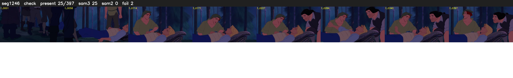

# Segment 1246 (shot)

Film frames 101948-102344 (397 frames, 71:52.1-71:08.6).

**Status: check**

| | |
|---|---|
| Frames with her hair | 25 / 397 |
| Mask source | SAM3 25, SAM2 fallback 0 |
| Frames still failing QC | 2 [131, 155] |
| Film indices with no picture (held) | 0 |
| Time | 746 s |

Top: source with the final mask outlined in red. Bottom: white-fill output.

## Issues

- tinted scene: median hair purity 0.00 < 0.5, purity/missed QC off
- fallback 131-131: no seed prompts (cleaned seed too small (0 px): hair lost)
- fallback 155-155: no seed prompts (cleaned seed too small (0 px): hair lost)
- other characters' hair erased on 385 frames
