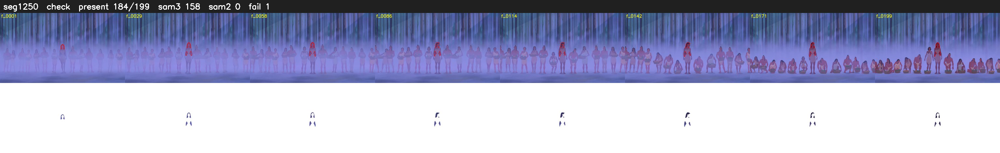

# Segment 1250 (shot)

Film frames 102529-102727 (199 frames, 71:16.3-71:24.6).

**Status: check**

| | |
|---|---|
| Frames with her hair | 184 / 199 |
| Mask source | SAM3 158, SAM2 fallback 0 |
| Frames still failing QC | 1 [33] |
| Film indices with no picture (held) | 0 |
| Time | 715 s |

Top: source with the final mask outlined in red. Bottom: white-fill output.

## Issues

- manual override: misty finale line-up: SAM3 loses her on single frames, hair blinks
- tinted scene: median hair purity 0.00 < 0.5, purity/missed QC off
- fallback 21-32: no seed prompts (cleaned seed too small (0 px): hair lost)
- fallback 51-55: no seed prompts (cleaned seed too small (0 px): hair lost)
- fallback 66-70: no seed prompts (cleaned seed too small (0 px): hair lost)
- fallback 73-75: no seed prompts (cleaned seed too small (0 px): hair lost)
- fallback 78-83: no seed prompts (cleaned seed too small (0 px): hair lost)
- fallback 85-87: no seed prompts (cleaned seed too small (0 px): hair lost)
- hold_gaps: 26 dropout frames hold the previous mask
- other characters' hair erased on 199 frames
