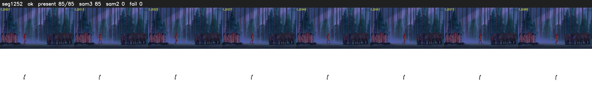

# Segment 1252 (shot)

Film frames 102778-102862 (85 frames, 71:26.7-72:30.2).

**Status: ok**

| | |
|---|---|
| Frames with her hair | 85 / 85 |
| Mask source | SAM3 85, SAM2 fallback 0 |
| Frames still failing QC | 0 [] |
| Film indices with no picture (held) | 0 |
| Time | 316 s |

Top: source with the final mask outlined in red. Bottom: white-fill output.

## Issues

- dusk scene: median hair purity 0.56 < 0.75, purity QC off
- other characters' hair erased on 85 frames
