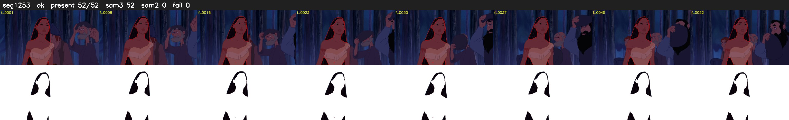

# Segment 1253 (shot)

Film frames 102863-102914 (52 frames, 72:30.2-72:32.4).

**Status: ok**

| | |
|---|---|
| Frames with her hair | 52 / 52 |
| Mask source | SAM3 52, SAM2 fallback 0 |
| Frames still failing QC | 0 [] |
| Film indices with no picture (held) | 0 |
| Time | 132 s |

Top: source with the final mask outlined in red. Bottom: white-fill output.

## Issues

- other characters' hair erased on 37 frames
