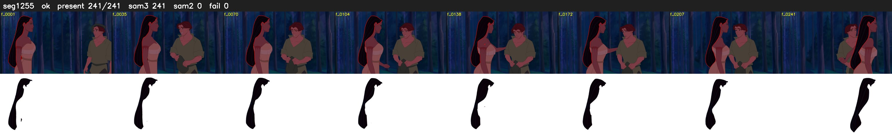

# Segment 1255 (shot)

Film frames 102977-103217 (241 frames, 72:35.0-72:45.1).

**Status: ok**

| | |
|---|---|
| Frames with her hair | 241 / 241 |
| Mask source | SAM3 241, SAM2 fallback 0 |
| Frames still failing QC | 0 [] |
| Film indices with no picture (held) | 0 |
| Time | 364 s |

Top: source with the final mask outlined in red. Bottom: white-fill output.
