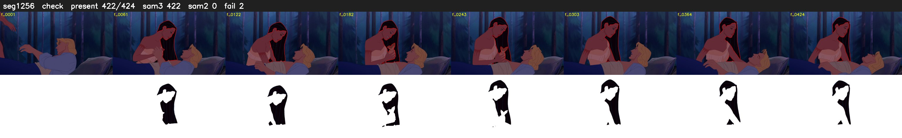

# Segment 1256 (shot)

Film frames 103218-103641 (424 frames, 72:45.1-72:02.7).

**Status: check**

| | |
|---|---|
| Frames with her hair | 422 / 424 |
| Mask source | SAM3 422, SAM2 fallback 0 |
| Frames still failing QC | 2 [3, 8] |
| Film indices with no picture (held) | 0 |
| Time | 653 s |

Top: source with the final mask outlined in red. Bottom: white-fill output.

## Issues

- other characters' hair erased on 2 frames
