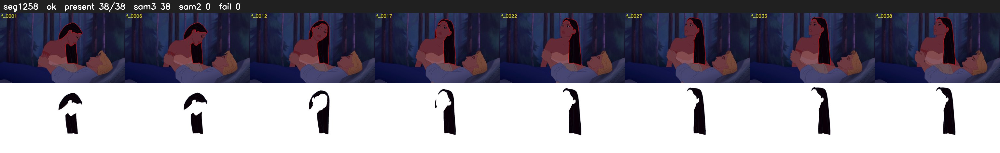

# Segment 1258 (shot)

Film frames 103688-103725 (38 frames, 72:04.7-72:06.2).

**Status: ok**

| | |
|---|---|
| Frames with her hair | 38 / 38 |
| Mask source | SAM3 38, SAM2 fallback 0 |
| Frames still failing QC | 0 [] |
| Film indices with no picture (held) | 0 |
| Time | 58 s |

Top: source with the final mask outlined in red. Bottom: white-fill output.
