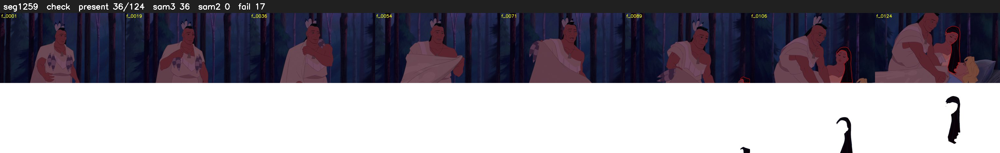

# Segment 1259 (shot)

Film frames 103726-103849 (124 frames, 72:06.2-72:11.4).

**Status: check**

| | |
|---|---|
| Frames with her hair | 36 / 124 |
| Mask source | SAM3 36, SAM2 fallback 0 |
| Frames still failing QC | 17 [89, 90, 91, 93, 108, 111, 112, 113, 116, 117, 118, 119, 120, 121, 122, 123, 124] |
| Film indices with no picture (held) | 0 |
| Time | 248 s |

Top: source with the final mask outlined in red. Bottom: white-fill output.

## Issues

- other characters' hair erased on 124 frames
