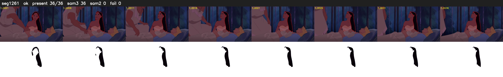

# Segment 1261 (shot)

Film frames 103912-103947 (36 frames, 72:14.0-72:15.5).

**Status: ok**

| | |
|---|---|
| Frames with her hair | 36 / 36 |
| Mask source | SAM3 36, SAM2 fallback 0 |
| Frames still failing QC | 0 [] |
| Film indices with no picture (held) | 0 |
| Time | 53 s |

Top: source with the final mask outlined in red. Bottom: white-fill output.
