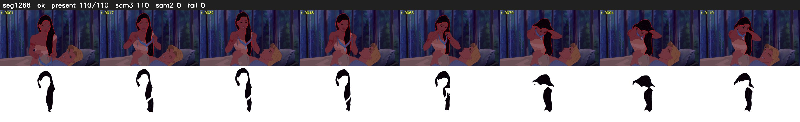

# Segment 1266 (shot)

Film frames 104253-104362 (110 frames, 72:28.2-73:32.8).

**Status: ok**

| | |
|---|---|
| Frames with her hair | 110 / 110 |
| Mask source | SAM3 110, SAM2 fallback 0 |
| Frames still failing QC | 0 [] |
| Film indices with no picture (held) | 0 |
| Time | 170 s |

Top: source with the final mask outlined in red. Bottom: white-fill output.
