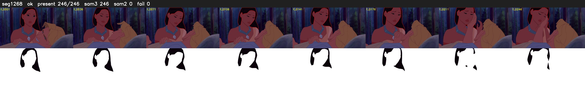

# Segment 1268 (shot)

Film frames 104565-104810 (246 frames, 73:41.2-73:51.5).

**Status: ok**

| | |
|---|---|
| Frames with her hair | 246 / 246 |
| Mask source | SAM3 246, SAM2 fallback 0 |
| Frames still failing QC | 0 [] |
| Film indices with no picture (held) | 0 |
| Time | 373 s |

Top: source with the final mask outlined in red. Bottom: white-fill output.
