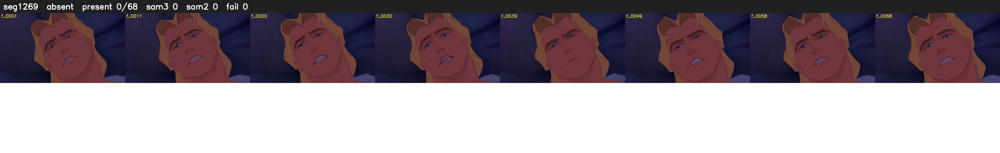

# Segment 1269 (shot)

Film frames 104811-104878 (68 frames, 73:51.5-73:54.3).

**Status: absent**

| | |
|---|---|
| Frames with her hair | 0 / 68 |
| Mask source | SAM3 0, SAM2 fallback 0 |
| Frames still failing QC | 0 [] |
| Film indices with no picture (held) | 0 |
| Time | 21 s |

Top: source with the final mask outlined in red. Bottom: white-fill output.

## Issues

- hair on 12/12 presence frames, none of it hers (best P 0.04)
