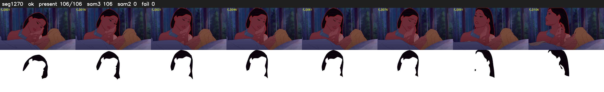

# Segment 1270 (shot)

Film frames 104879-104984 (106 frames, 73:54.3-73:58.7).

**Status: ok**

| | |
|---|---|
| Frames with her hair | 106 / 106 |
| Mask source | SAM3 106, SAM2 fallback 0 |
| Frames still failing QC | 0 [] |
| Film indices with no picture (held) | 0 |
| Time | 160 s |

Top: source with the final mask outlined in red. Bottom: white-fill output.
