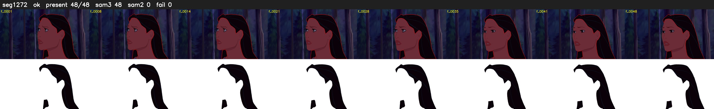

# Segment 1272 (shot)

Film frames 105045-105092 (48 frames, 73:01.3-73:03.3).

**Status: ok**

| | |
|---|---|
| Frames with her hair | 48 / 48 |
| Mask source | SAM3 48, SAM2 fallback 0 |
| Frames still failing QC | 0 [] |
| Film indices with no picture (held) | 0 |
| Time | 75 s |

Top: source with the final mask outlined in red. Bottom: white-fill output.
