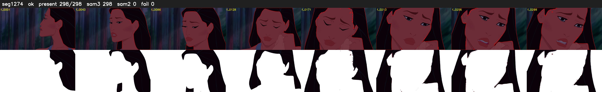

# Segment 1274 (shot)

Film frames 105169-105466 (298 frames, 73:06.4-73:18.9).

**Status: ok**

| | |
|---|---|
| Frames with her hair | 298 / 298 |
| Mask source | SAM3 298, SAM2 fallback 0 |
| Frames still failing QC | 0 [] |
| Film indices with no picture (held) | 0 |
| Time | 438 s |

Top: source with the final mask outlined in red. Bottom: white-fill output.
