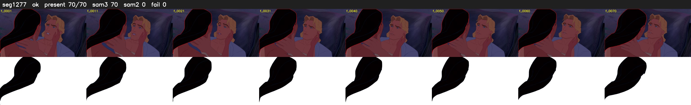

# Segment 1277 (shot)

Film frames 105635-105704 (70 frames, 73:25.9-73:28.8).

**Status: ok**

| | |
|---|---|
| Frames with her hair | 70 / 70 |
| Mask source | SAM3 70, SAM2 fallback 0 |
| Frames still failing QC | 0 [] |
| Film indices with no picture (held) | 0 |
| Time | 107 s |

Top: source with the final mask outlined in red. Bottom: white-fill output.
