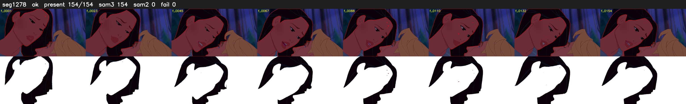

# Segment 1278 (shot)

Film frames 105705-105858 (154 frames, 73:28.8-74:35.2).

**Status: ok**

| | |
|---|---|
| Frames with her hair | 154 / 154 |
| Mask source | SAM3 154, SAM2 fallback 0 |
| Frames still failing QC | 0 [] |
| Film indices with no picture (held) | 0 |
| Time | 229 s |

Top: source with the final mask outlined in red. Bottom: white-fill output.
