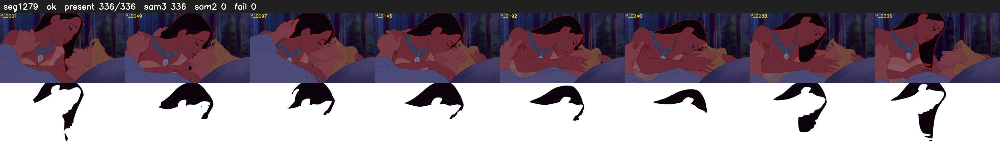

# Segment 1279 (shot)

Film frames 105859-106194 (336 frames, 74:35.2-74:49.2).

**Status: ok**

| | |
|---|---|
| Frames with her hair | 336 / 336 |
| Mask source | SAM3 336, SAM2 fallback 0 |
| Frames still failing QC | 0 [] |
| Film indices with no picture (held) | 0 |
| Time | 509 s |

Top: source with the final mask outlined in red. Bottom: white-fill output.
