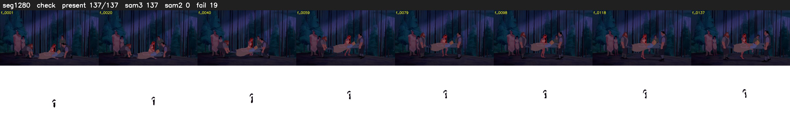

# Segment 1280 (shot)

Film frames 106195-106331 (137 frames, 74:49.2-74:54.9).

**Status: check**

| | |
|---|---|
| Frames with her hair | 137 / 137 |
| Mask source | SAM3 137, SAM2 fallback 0 |
| Frames still failing QC | 19 [31, 32, 33, 34, 35, 36, 38, 67, 68, 103, 104, 105, 106, 107, 108, 109, 110, 111, 112] |
| Film indices with no picture (held) | 0 |
| Time | 457 s |

Top: source with the final mask outlined in red. Bottom: white-fill output.

## Issues

- fallback 31-36: no seed prompts (cleaned seed too small (3377 px): hair lost)
- fallback 38-38: no seed prompts (cleaned seed too small (3341 px): hair lost)
- fallback 67-68: no seed prompts (cleaned seed too small (3838 px): hair lost)
- fallback 103-112: no seed prompts (cleaned seed too small (2914 px): hair lost)
- other characters' hair erased on 137 frames
