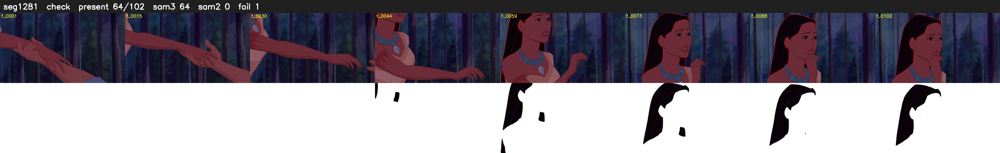

# Segment 1281 (shot)

Film frames 106332-106433 (102 frames, 74:54.9-74:59.2).

**Status: check**

| | |
|---|---|
| Frames with her hair | 64 / 102 |
| Mask source | SAM3 64, SAM2 fallback 0 |
| Frames still failing QC | 1 [39] |
| Film indices with no picture (held) | 0 |
| Time | 150 s |

Top: source with the final mask outlined in red. Bottom: white-fill output.

## Issues

- other characters' hair erased on 24 frames
