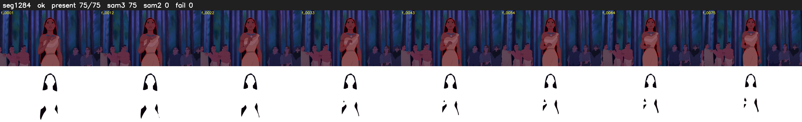

# Segment 1284 (shot)

Film frames 106603-106677 (75 frames, 74:06.2-74:09.4).

**Status: ok**

| | |
|---|---|
| Frames with her hair | 75 / 75 |
| Mask source | SAM3 75, SAM2 fallback 0 |
| Frames still failing QC | 0 [] |
| Film indices with no picture (held) | 0 |
| Time | 257 s |

Top: source with the final mask outlined in red. Bottom: white-fill output.

## Issues

- other characters' hair erased on 75 frames
