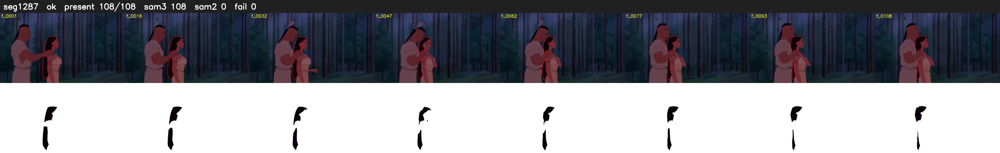

# Segment 1287 (shot)

Film frames 106786-106893 (108 frames, 74:13.9-74:18.4).

**Status: ok**

| | |
|---|---|
| Frames with her hair | 108 / 108 |
| Mask source | SAM3 108, SAM2 fallback 0 |
| Frames still failing QC | 0 [] |
| Film indices with no picture (held) | 0 |
| Time | 222 s |

Top: source with the final mask outlined in red. Bottom: white-fill output.

## Issues

- other characters' hair erased on 108 frames
