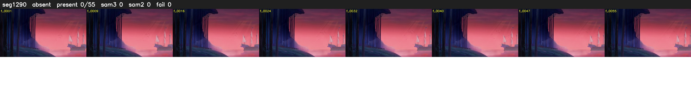

# Segment 1290 (shot)

Film frames 107010-107064 (55 frames, 74:23.2-74:25.5).

**Status: absent**

| | |
|---|---|
| Frames with her hair | 0 / 55 |
| Mask source | SAM3 0, SAM2 fallback 0 |
| Frames still failing QC | 0 [] |
| Film indices with no picture (held) | 0 |
| Time | 15 s |

Top: source with the final mask outlined in red. Bottom: white-fill output.
