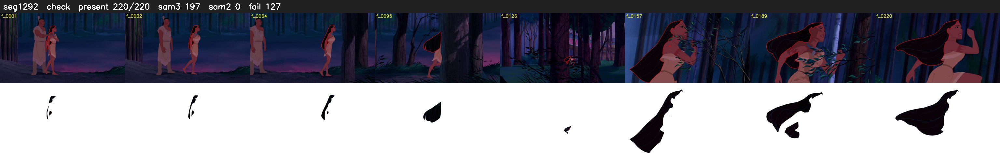

# Segment 1292 (shot)

Film frames 107125-107344 (220 frames, 74:28.0-75:37.2).

**Status: check**

| | |
|---|---|
| Frames with her hair | 220 / 220 |
| Mask source | SAM3 197, SAM2 fallback 0 |
| Frames still failing QC | 127 [72, 73, 76, 77, 78, 79, 80, 81, 82, 83, 84, 85, 86, 87, 88, 89, 90, 92, 99, 100] |
| Film indices with no picture (held) | 0 |
| Time | 378 s |

Top: source with the final mask outlined in red. Bottom: white-fill output.

## Issues

- manual override: SAM2 fallback spilled onto tree trunks in the forest run (f92, f171); hold_gaps for 23 dropouts while she's small behind trunks
- hold_gaps: 23 dropout frames hold the previous mask
- other characters' hair erased on 74 frames
