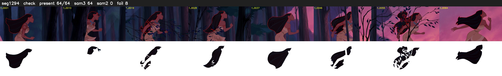

# Segment 1294 (shot)

Film frames 107409-107472 (64 frames, 75:39.9-75:42.5).

**Status: check**

| | |
|---|---|
| Frames with her hair | 64 / 64 |
| Mask source | SAM3 64, SAM2 fallback 0 |
| Frames still failing QC | 8 [4, 9, 10, 30, 41, 42, 43, 49] |
| Film indices with no picture (held) | 0 |
| Time | 105 s |

Top: source with the final mask outlined in red. Bottom: white-fill output.

## Issues

- dark scene: 55% of frames fail 'missed', missed QC off
- other characters' hair erased on 5 frames
