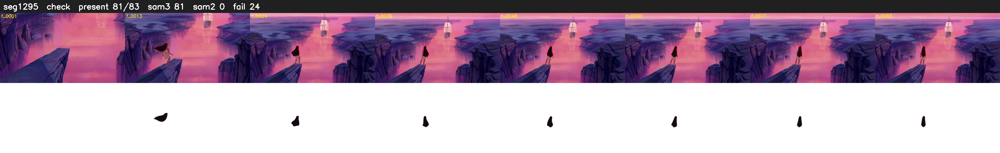

# Segment 1295 (shot)

Film frames 107473-107555 (83 frames, 75:42.5-75:46.0).

**Status: check**

| | |
|---|---|
| Frames with her hair | 81 / 83 |
| Mask source | SAM3 81, SAM2 fallback 0 |
| Frames still failing QC | 24 [3, 58, 61, 62, 64, 65, 66, 67, 68, 69, 70, 71, 72, 73, 74, 75, 76, 77, 78, 79] |
| Film indices with no picture (held) | 0 |
| Time | 132 s |

Top: source with the final mask outlined in red. Bottom: white-fill output.
