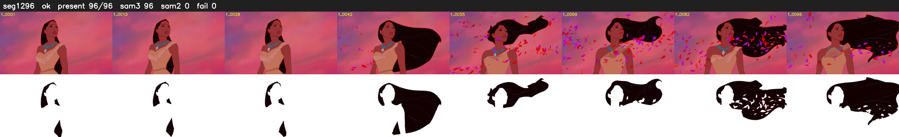

# Segment 1296 (shot)

Film frames 107556-107651 (96 frames, 75:46.0-75:50.0).

**Status: ok**

| | |
|---|---|
| Frames with her hair | 96 / 96 |
| Mask source | SAM3 96, SAM2 fallback 0 |
| Frames still failing QC | 0 [] |
| Film indices with no picture (held) | 0 |
| Time | 162 s |

Top: source with the final mask outlined in red. Bottom: white-fill output.
