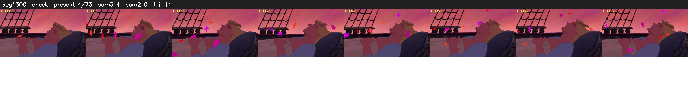

# Segment 1300 (shot)

Film frames 107861-107933 (73 frames, 75:58.7-75:01.7).

**Status: check**

| | |
|---|---|
| Frames with her hair | 4 / 73 |
| Mask source | SAM3 4, SAM2 fallback 0 |
| Frames still failing QC | 11 [56, 57, 58, 59, 60, 62, 63, 64, 65, 66, 67] |
| Film indices with no picture (held) | 0 |
| Time | 150 s |

Top: source with the final mask outlined in red. Bottom: white-fill output.

## Issues

- tinted scene: median hair purity 0.00 < 0.5, purity/missed QC off
- fallback 56-60: no seed prompts (cleaned seed too small (0 px): hair lost)
- fallback 62-67: no seed prompts (cleaned seed too small (0 px): hair lost)
- other characters' hair erased on 70 frames
