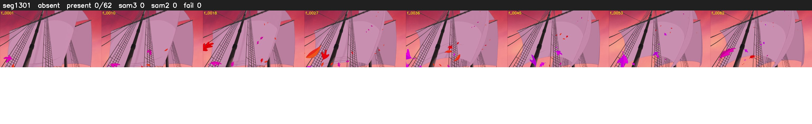

# Segment 1301 (shot)

Film frames 107934-107995 (62 frames, 75:01.7-75:04.3).

**Status: absent**

| | |
|---|---|
| Frames with her hair | 0 / 62 |
| Mask source | SAM3 0, SAM2 fallback 0 |
| Frames still failing QC | 0 [] |
| Film indices with no picture (held) | 0 |
| Time | 15 s |

Top: source with the final mask outlined in red. Bottom: white-fill output.
