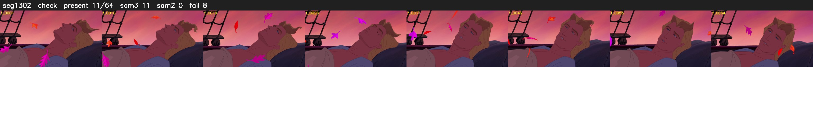

# Segment 1302 (shot)

Film frames 107996-108059 (64 frames, 75:04.3-75:07.0).

**Status: check**

| | |
|---|---|
| Frames with her hair | 11 / 64 |
| Mask source | SAM3 11, SAM2 fallback 0 |
| Frames still failing QC | 8 [51, 52, 53, 54, 55, 57, 59, 60] |
| Film indices with no picture (held) | 0 |
| Time | 147 s |

Top: source with the final mask outlined in red. Bottom: white-fill output.

## Issues

- tinted scene: median hair purity 0.00 < 0.5, purity/missed QC off
- fallback 51-55: no seed prompts (cleaned seed too small (0 px): hair lost)
- fallback 57-57: no seed prompts (cleaned seed too small (0 px): hair lost)
- fallback 59-60: no seed prompts (cleaned seed too small (0 px): hair lost)
- other characters' hair erased on 56 frames
