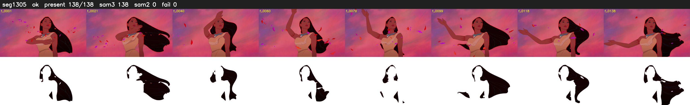

# Segment 1305 (shot)

Film frames 108216-108353 (138 frames, 75:13.5-75:19.3).

**Status: ok**

| | |
|---|---|
| Frames with her hair | 138 / 138 |
| Mask source | SAM3 138, SAM2 fallback 0 |
| Frames still failing QC | 0 [] |
| Film indices with no picture (held) | 0 |
| Time | 221 s |

Top: source with the final mask outlined in red. Bottom: white-fill output.
