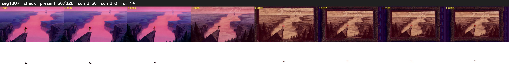

# Segment 1307 (shot)

Film frames 108482-108701 (220 frames, 75:24.6-76:33.8).

**Status: check**

| | |
|---|---|
| Frames with her hair | 56 / 220 |
| Mask source | SAM3 56, SAM2 fallback 0 |
| Frames still failing QC | 14 [21, 22, 25, 26, 28, 41, 42, 71, 72, 73, 74, 75, 76, 77] |
| Film indices with no picture (held) | 0 |
| Time | 363 s |

Top: source with the final mask outlined in red. Bottom: white-fill output.

## Issues

- fallback 21-22: no seed prompts (cleaned seed too small (2034 px): hair lost)
- fallback 25-26: no seed prompts (cleaned seed too small (2102 px): hair lost)
- fallback 28-28: no seed prompts (cleaned seed too small (1868 px): hair lost)
- fallback 41-42: no seed prompts (cleaned seed too small (1858 px): hair lost)
- fallback 71-77: no seed prompts (cleaned seed too small (1485 px): hair lost)
